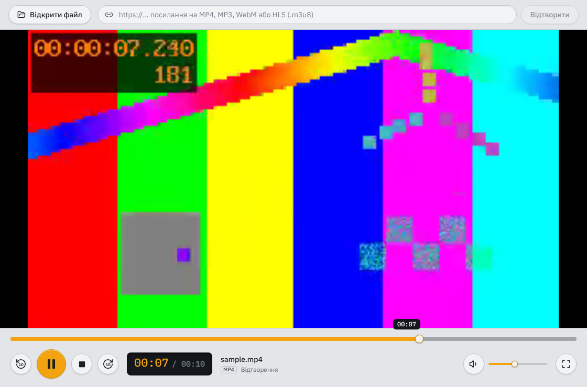
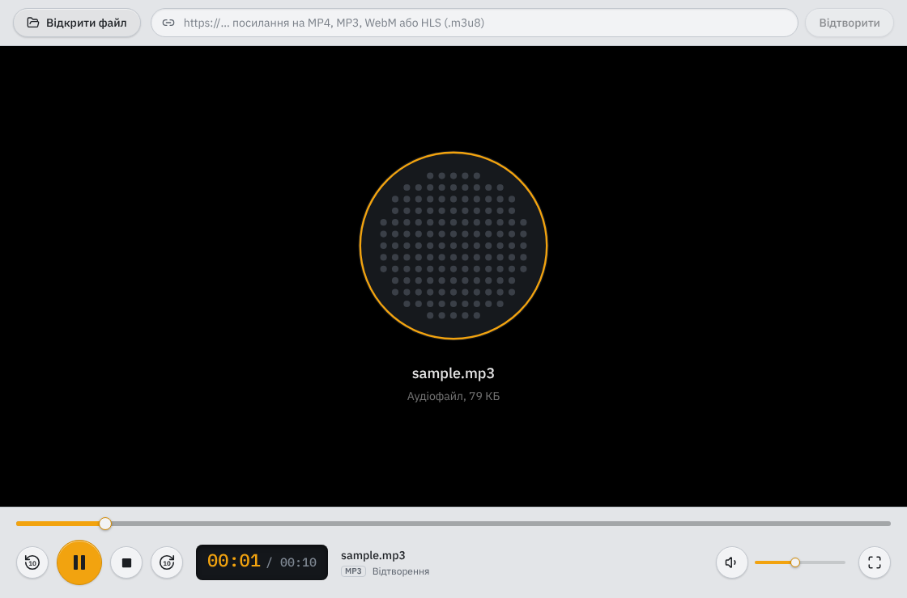
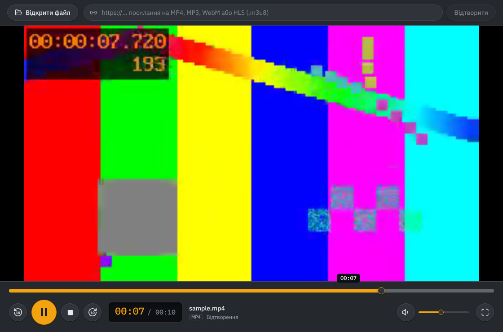

# Медіапрогравач — лабораторна робота №2

Desktop-застосунок для відтворення аудіо та відео з локальних файлів і за URL.
Стек: **Electron + React + TypeScript**, збірка **electron-vite**, стилі **Tailwind CSS**.



| Аудіо | Темна тема |
|---|---|
|  |  |

## Запуск

Потрібен Node.js ≥ 22.18.

```bash
npm install
npm run dev          # режим розробки з hot reload
npm start            # production-збірка без інсталятора
npm run dist:win     # інсталятор і portable .exe у dist/
```

## Відповідність вимогам

| Вимога | Реалізація |
|---|---|
| Відкриття локального медіафайлу | Нативний діалог (`dialog.showOpenDialog`) з фільтрами форматів, меню «Файл → Відкрити файл» (Ctrl+O), drag & drop у вікно |
| Play / Pause, Stop | `play()` / `pause()`; Stop = пауза + `currentTime = 0` і окремий статус «Зупинено» |
| Перехід вперед/назад | Кнопки ±10 с, клавіші ←/→ (±5 с) та J/L (±10 с) |
| Progress bar | Власний слайдер: клік, перетягування з переглядом кадру, підказка часу під курсором, смуга буферизації |
| Поточний і загальний час | Таймкод-дисплей `00:07 / 00:10`, для довгих файлів `1:02:09`; для прямого ефіру — «наживо» |
| Гучність | Слайдер, кнопка вимкнення звуку, клавіші ↑/↓ і M; рівень зберігається між запусками |
| ≥ 2 аудіо- та ≥ 2 відеоформати | Аудіо: MP3, WAV, OGG, Opus, FLAC, M4A, AAC. Відео: MP4, M4V, WebM, MKV, MOV |
| Відтворення за URL | Поле посилання вгорі (Ctrl+L). Прямі http(s)-посилання на файли, а також HLS (`.m3u8`) через бібліотеку hls.js |

## Гарячі клавіші

| Клавіша | Дія |
|---|---|
| Пробіл, K | Відтворити / пауза |
| S | Стоп |
| ← / → | −5 / +5 с |
| J / L | −10 / +10 с |
| ↑ / ↓ | Гучність ±5% |
| M | Вимкнути / увімкнути звук |
| F, подвійний клік по відео | Повноекранний режим |
| Ctrl+O | Відкрити файл |
| Ctrl+L | Перейти до поля посилання |

Клавіші прив'язані до `KeyboardEvent.code`, тож працюють і з українською розкладкою.

## Архітектура

```
src/
├── main/                  Main-процес (Node.js): вікно, меню, діалоги, доступ до файлів
│   ├── index.ts           створення вікна, IPC-обробник діалогу відкриття
│   ├── mediaProtocol.ts   протокол media:// для локальних файлів
│   ├── range.ts           розбір HTTP Range (покритий unit-тестами)
│   └── menu.ts            меню застосунку
├── preload/index.ts       міст: відкриває renderer-у лише window.mediaApi
├── shared/                спільне для всіх процесів: формати, канали IPC, типи
└── renderer/src/          React UI
    ├── hooks/useMediaPlayer.ts   уся логіка відтворення (стан, події, дії, hls.js)
    ├── components/               Toolbar, Stage, ControlDeck, Slider…
    └── lib/                      форматування часу, створення джерел відтворення
```

**Розділення процесів.** Renderer працює з `contextIsolation`, `sandbox` і без `nodeIntegration`, тобто як звичайна вебсторінка. Усе, що потребує ОС, проходить через `preload → IPC → main`.

**Чому власний протокол `media://`, а не `file://`.** Щоб відтворити локальний файл через `file://`, довелося б вимкнути `webSecurity`. Натомість main-процес реєструє схему `media://` і віддає лише ті файли, які користувач сам обрав у діалозі (за випадковим id). Обробник відповідає `206 Partial Content` на заголовок `Range`: саме так Chromium перемотує `<video>`. Без цього progress bar не працював би на великих файлах.

**Один `<video>` для аудіо та відео.** Для аудіо `videoWidth === 0`, тож тип вмісту визначається фактично після `loadedmetadata`, а не лише за розширенням. Для аудіо на сцені показується «решітка динаміка» з назвою файлу.

**Плавний progress bar.** Подія `timeupdate` приходить ~4 рази на секунду, тому під час відтворення позиція оновлюється через `requestAnimationFrame`.

## Формати й обмеження

Формат = контейнер + кодек. Electron містить власну збірку FFmpeg з H.264/AAC/MP3, тому набір кодеків не залежить від того, що встановлено в системі. Усі перелічені формати перевірено на вбудованому в Electron Chromium, дев'ять із них — в e2e-тесті.

- MKV і MOV відтворюються, коли всередині H.264, VP9 або AV1. HEVC (H.265) працює лише за наявності апаратного декодера, тож не гарантований; звук AC-3/DTS Chromium не підтримує.
- AVI і WMV не підтримуються.
- HLS (`.m3u8`) працює через hls.js. MPEG-DASH (`.mpd`) за умовою не вимагається; застосунок показує зрозуміле повідомлення.
- URL-джерело має бути доступне без авторизації.

## Тести

```bash
npm run test:unit    # розбір HTTP Range
npm run test:e2e     # 31 перевірка на справжньому Electron через Playwright
```

E2E-тест підміняє нативний діалог у main-процесі, відкриває кожен із 9 тестових файлів, перевіряє перемотування, паузу, Stop, ±10 с, гучність, відтворення за URL і HLS з локального сервера, обробку помилок, drag & drop і меню. Скриншоти зберігаються в `tests/screenshots/`. На Linux без дисплея: `xvfb-run -a npm run test:e2e`.

Тестові файли лежать у `tests/fixtures/` (перестворити: `tests/make-fixtures.sh`, потрібен ffmpeg).

### Демонстрація відтворення за URL без інтернету

```bash
npm run serve:fixtures
```

Сервер з підтримкою Range виведе посилання на кшталт `http://127.0.0.1:8080/sample.mp4` та `http://127.0.0.1:8080/hls/index.m3u8` — вставте їх у поле посилання.
